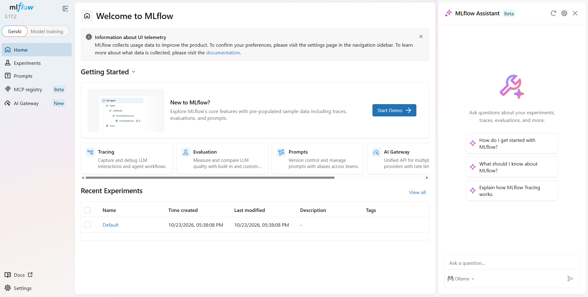

\# AI/ML Internship - W1D1


\## Objective

Set up and run MLflow locally.


\## Tools Used

\- Python 3.12.10

\- MLflow

\- Scikit-learn

\- Pandas

\- VS Code

\- Git


\## Completed Tasks

\- Created a Python virtual environment.

\- Installed required Python libraries.

\- Successfully launched the MLflow UI.


\## Application URL

http://127.0.0.1:5000


\## Deliverable

Screenshot of the running MLflow dashboard.
## Output Screenshot



## W1D2: Project Folder Structure

### Directories
- `assets/` — Stores screenshots and supporting project files.
- `venv/` — Python virtual environment.
- `ai-ml-internship/` — Project workspace folder.

### Key Files
- `numpy_fundamentals.py` — NumPy practice code.
- `ML-1.md` — Machine learning notes/documentation.
- `mlflow.db` — MLflow tracking database.
- `mlflow-screenshot.png` — MLflow screenshot.
- `.gitignore` — Files excluded from Git tracking.
- `README.md` — Project setup and documentation.

## W1D3: Data Flow

### Input
The program creates sample 1D, 2D, and 3D NumPy arrays in the Python script.

### Processing
- Creates NumPy arrays.
- Displays array shapes.
- Performs vectorized multiplication.
- Demonstrates broadcasting.
- Performs matrix multiplication.

### Output
The program prints arrays, their shapes, and calculation results in the terminal.

### Data Flow Diagram

```text
NumPy Sample Arrays
        |
        v
Array Creation
        |
        v
Shape Inspection
        |
        v
Vectorized Operations
        |
        v
Broadcasting and Matrix Multiplication
        |
        v
Results Printed in Terminal
```

### ML Experiment Lifecycle
- Tracking: Records experiment parameters and metrics.
- Model Registry: Organizes and versions trained models.
- Artifact Storage: Stores experiment outputs, models, and related files.

## W1D5: Data Visualisation and MLflow Experiment

### Dataset
- Dataset: Iris
- Rows: 150
- Columns: 5

### Visualisation
- Created a histogram of sepal length using Matplotlib.
- Saved the chart as `results/week1_visualization.png`.

### MLflow Experiment
- Experiment name: `Default`
- Run name: `Iris_Week1_Analysis`
- Parameters logged: dataset, rows, features
- Metric logged: mean_sepal_length

### Results
The Iris dataset was loaded using pandas and analysed successfully.
A sepal length distribution chart was generated and saved.
The experiment parameters and mean sepal length metric were logged in MLflow.

